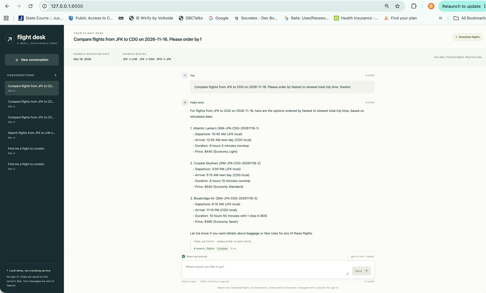
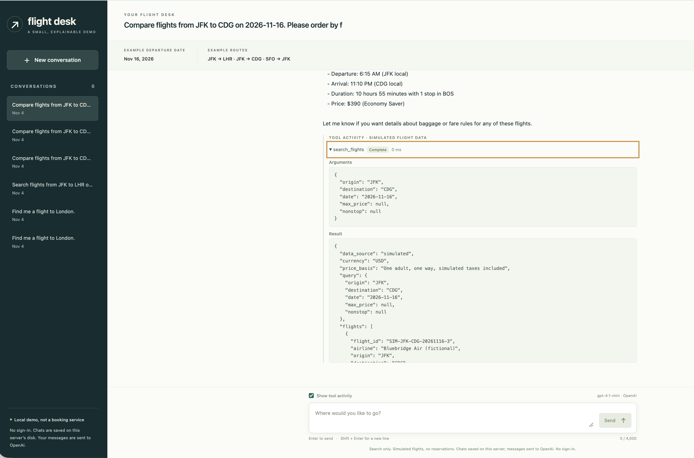
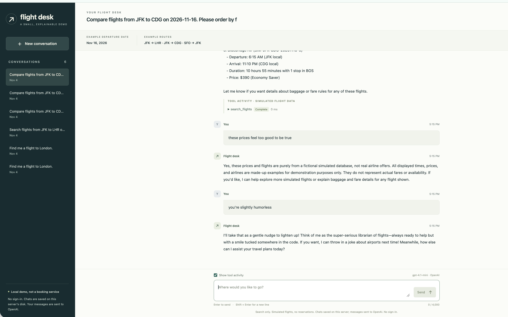

# Flight assistant

A small interview demo of **real LLM tool calling over clearly simulated flight data**. FastAPI serves a lightweight browser UI; SQLite keeps conversations, messages, and tool-call arguments/results/errors. An optional terminal client uses the same backend logic. Search and comparison only: no booking, payment, RAG, or frontend build pipeline.

## Screenshots

**1. Flight comparison** — multiple simulated options ordered by total trip duration.



**2. Tool trace** — inspect the requested function, arguments, and structured simulated results.



**3. Conversational follow-ups and feedback** — simulated-data disclosure and conversation-level ratings.



## Run

Requires Python 3.11+ and [uv](https://docs.astral.sh/uv/), plus an OpenAI API key with access to the configured model. LLM calls incur your account's API charges.

```sh
cp .env.example .env
# Edit .env: set OPENAI_API_KEY. Never commit or share the key.
uv sync --extra dev
uv run uvicorn flight_assistant.app:app --host 127.0.0.1 --port 8000
```

Open <http://127.0.0.1:8000>. Without a key, the app still starts and explains the missing configuration; it never substitutes a fake model. Restart the server after editing `.env`.

Terminal alternative:

```sh
uv run flight-assistant --trace
```

## Try it

All flight inventory, prices, baggage rules, and availability are **fictional**, in USD. Any valid departure date works for any distinct pair of supported airports: **JFK, LHR, CDG, SFO, ATL, LAX, ORD, BOS, MIA**. Each route/date has three options: two nonstop flights and one cheaper connecting flight. The displayed date/routes are examples, not restrictions; restrictive filters can still return no matches.

1. **Clarification:** “Find me a flight to London.” Supply JFK and 2026-11-16 when asked.
2. **Search:** “Search JFK to LHR on 2026-11-16.”
3. **Follow-up:** “Only nonstop, under $600.” Then ask about baggage for a returned flight ID.
4. **No results:** Search the same route with a $1 maximum. An empty result is not a provider outage.
5. **History:** Refresh or restart the server, reopen the conversation, and ask a follow-up.
6. **Tool failure:** Set `FLIGHT_SIMULATE_FAILURE=1` in `.env`, restart, and request a fresh search. The UI identifies the intentional simulated outage; tools return errors rather than fabricated flights. Restore `0` afterwards.

Enable **tool trace** to inspect model-requested tool names, arguments, returned data/errors, and timings. This is observable execution, not private model reasoning.

**New conversation** immediately creates and selects a saved empty chat; previous chats remain in the sidebar. After an assistant reply, choose **Helpful** or **Not helpful** to rate that conversation. Select the same choice again to clear it. Ratings survive refreshes and restarts; this local app has one shared rating per conversation, not separate user accounts.

## How it works

The model either asks a clarifying question, answers from existing evidence, or requests an allowlisted function. Python validates the arguments, generates simulated flights or retrieves their details, then sends structured results back to the model. SHA-256 of the route and date makes schedules and prices deterministic across process restarts. Flight IDs encode the route, date, and option so detail lookups can regenerate the same flight without a flight database. SQLite stores conversations, ratings, messages, and tool evidence.

Read the code in this order: `tools.py` (schemas and deterministic generator), `service.py` (OpenAI Responses API loop), `store.py` (SQLite and replayable turns), then `app.py` / `static/app.js` (HTTP and UI). The CLI is `cli.py`.

Per turn: at most **5 model invocations**, **8 tool executions**, and **1,800 output tokens per invocation**. The OpenAI client uses **`max_retries=2`** for retryable failures: up to three attempts per invocation, with a **20-second SDK timeout per attempt**. Retries and backoff can increase overall latency. Provider context keeps at most **12 whole turns** within **48,000 serialized characters**, including balanced tool evidence from failed turns; older chat remains visible in SQLite but is not necessarily sent to the model. Missing context requires clarification, not guessing. Input is capped at 4,000 characters.

Settings in `.env`:

| Variable | Default | Purpose |
| --- | --- | --- |
| `OPENAI_API_KEY` | unset | Server-side OpenAI credential |
| `OPENAI_MODEL` | `gpt-4.1-mini` | Tool-capable OpenAI model |
| `FLIGHT_DB_PATH` | `data/flights.sqlite3` | Local SQLite history |
| `FLIGHT_SIMULATE_FAILURE` | `0` | Set `1` to demonstrate a simulated flight-tool outage |

## Verify

```sh
uv run pytest
```

Deterministic tests cover generated routes/dates, stable cross-process results, filtering, retry recovery/exhaustion, execution/context limits, rating persistence, and migration without losing history. Browser checks cover immediate chat creation, rating changes/clearing, failures, navigation during a save, and desktop/mobile layouts without paid model calls. Earlier live checks with `gpt-4.1-mini` exercised clarification, search, follow-ups, empty results, tool outages, and history after restart. To repeat live checks, configure your key and perform the demo above. Scripted-provider tests do **not** prove real-model behavior; wording and decisions can vary.

## Scope and tradeoffs

- Local single-user demo. No authentication: bind to loopback, not a public interface. Conversations and tool results are stored as plaintext on disk; user messages and retained conversation context are sent to OpenAI. Do not enter sensitive passenger information.
- Simulated flight data is intentional: deterministic searches make the tool-calling behavior easy to inspect. No external flight API account is required.
- Existing chats keep their historical results. If a chat contains old fixed-catalog flight IDs, run a fresh search to get IDs for the generated catalogue.
- A real flight provider is an optional extension, **not implemented**. [Amadeus](https://developers.amadeus.com/pricing) advertises monthly test quotas; [Duffel test mode](https://duffel.com/docs/api/overview/test-mode/duffel-airways) provides a sandbox, including fictional Duffel Airways with unrealistic schedules/prices. Check current access terms and production pricing before integrating. Sandbox results must remain labeled as such.
- A real integration should return provider-supplied offer URLs when available. It must not manufacture a booking link or imply that a search result is a reservation.
- `AGENTS.md` records the coding and verification rules for future changes.
